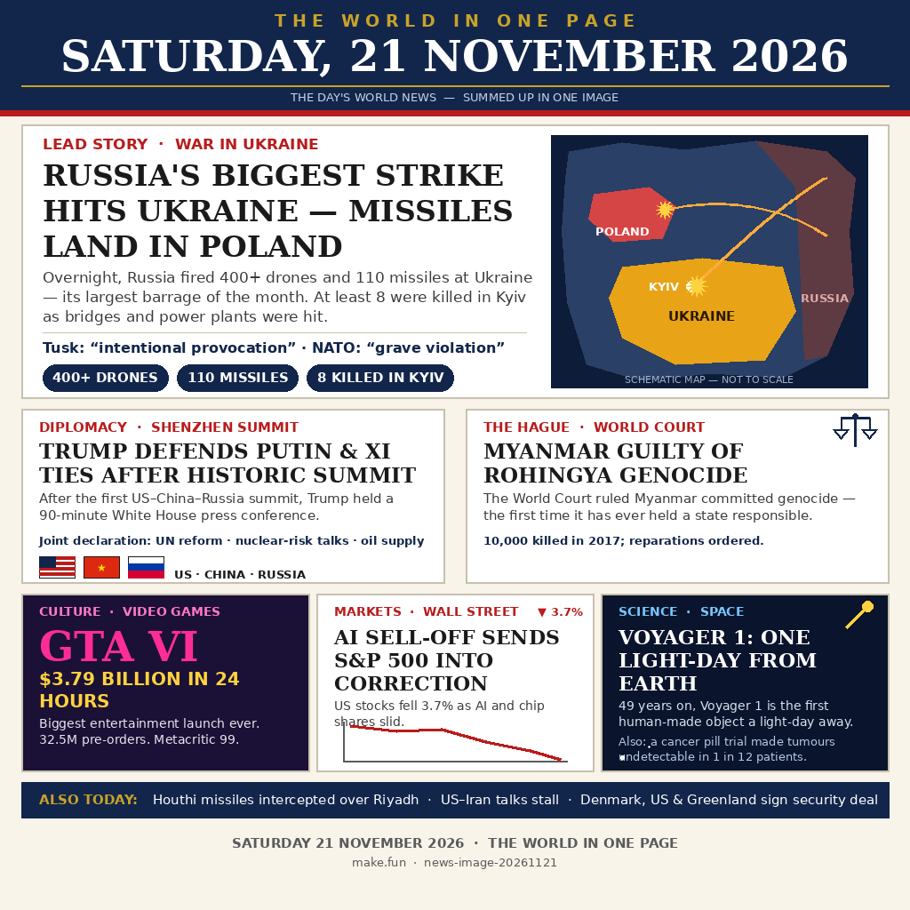

# The World in One Page — Saturday, 21 November 2026

[](https://make.fun/bounty/news-image-20261121)
[](https://make.fun/bounty/news-image-20261121)
[](LICENSE)

A one-page newspaper front page that sums up the world's news of
**Saturday, 21 November 2026** in a single 1024×1024 image — built for the
[make.fun bounty "Sum up 21 November's world news in one image"](https://make.fun/bounty/news-image-20261121)
($100, 50 places paid: $20 / $12 / $6 / $2 ×7 / $1.20 ×40).



## What's on the page

| Panel | Story |
|---|---|
| **Lead story** | Russia's biggest strike of the month on Ukraine — 400+ drones and 110 missiles overnight, 8 killed in Kyiv; two missiles and a drone came down in Poland. PM Tusk: "intentional provocation"; NATO: "grave violation". |
| **Diplomacy** | Trump defends his Putin & Xi ties after the first-ever US–China–Russia trilateral summit in Shenzhen, then a 90-minute White House press conference. |
| **World Court** | The ICJ rules Myanmar committed genocide against the Rohingya — the first time it has ever held a state responsible. ~10,000 killed in 2017; reparations ordered. |
| **Culture** | GTA VI: $3.79 billion in 24 hours — the biggest entertainment launch ever. 32.5M pre-orders, Metacritic 99. |
| **Markets** | AI sell-off sends the S&P 500 into correction; US stocks fell 3.7%. |
| **Science** | Voyager 1 becomes the first human-made object one light-day from Earth; a pancreatic-cancer pill trial made tumours undetectable in 1 in 12 patients. |
| **Also today** | Houthi missiles intercepted over Riyadh · US–Iran talks stall · Denmark, US & Greenland sign a security deal. |

## Sources (checked 21 Nov 2026)

- Russia / Poland strikes: AP, Institute for the Study of War (20 Nov 2026 assessment)
- Shenzhen summit & Trump press conference: USA Today, NY Post, Fox News (20 Nov 2026)
- ICJ Myanmar genocide ruling (19 Nov 2026): CNN, Reuters, Wall Street Journal, Human Rights Watch, Amnesty International
- GTA VI launch figures: Game Informer, Barron's, Pure Xbox (20 Nov 2026)
- Markets, Voyager 1, cancer pill, Riyadh: oneturn.news day page for 21 Nov 2026

## How it works

`main.ts` (Node 22, standard library only) copies the pre-rendered front
page `entry.png` to the output directory. The image itself is drawn by
`tools/generate_image.py` (Pillow, run during the build session) — a
deterministic newspaper layout: masthead, lead story with a schematic map,
and five more news panels. The program uses no network and writes the same
bytes on every run.

```sh
mkdir -p out && MAKEFUN_OUTPUT_DIR=out node main.ts   # writes out/entry.png
python3 tools/generate_image.py                        # redraw entry.png
```

Output: one PNG, 1024×1024, under 1 MiB.

## License

MIT — see [LICENSE](LICENSE).
